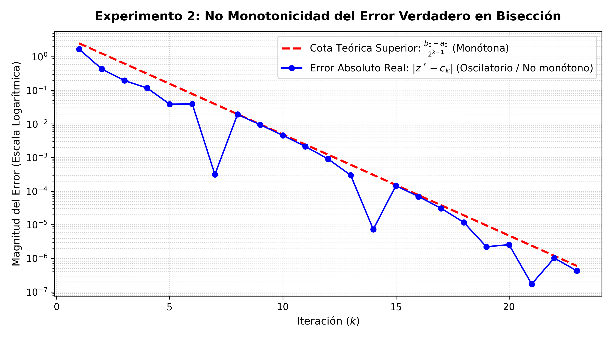

# Informe de Resultados Experimentales: Determinación Numérica del Corrimiento al Rojo ($z$) Mediante el Método de Bisección

**Asignatura:** Análisis Numérico  
**Modelo Físico:** Expansión Cosmológica $\Lambda$CDM Plano  
**Problema:** Resolución de la ecuación residual no lineal $f(z) = D_L(z) - D_{\text{obs}} = 0$  
**Fecha de experimentación:** Octubre de 2026  

---

## 1. Resumen Ejecutivo y Parámetros del Modelo
En este trabajo se implementó y analizó el comportamiento numérico y computacional del **Método de Bisección** para determinar el corrimiento al rojo ($z$) de una supernova lejana de tipo Ia a partir de su distancia de luminosidad observada ($D_{\text{obs}}$).

Los parámetros cosmológicos adoptados corresponden al modelo estándar $\Lambda$CDM plano:
- **Velocidad de la luz ($c$):** $299\,792.458\text{ km/s}$
- **Constante de Hubble ($H_0$):** $70.0\text{ (km/s)/Mpc}$
- **Densidad de materia ($\Omega_m$):** $0.3$
- **Densidad de energía oscura ($\Omega_\Lambda$):** $0.7$
- **Corrimiento al rojo exacto de referencia ($z^*$):** $0.8200$
- **Distancia de luminosidad observada ($D_{\text{obs}}$):** $5172.5730\text{ Mpc}$

La distancia teórica se calcula a través de la integral elíptica:
$$D_L(z) = \frac{c(1+z)}{H_0} \int_0^z \frac{dz'}{\sqrt{\Omega_m(1+z')^3 + \Omega_\Lambda}}$$
La cual carece de primitiva analítica elemental, requiriendo cuadratura numérica adaptativa y búsqueda de raíces para despejar $z$.

---

## 2. Experimento 1: Validación de Convergencia y Verificación de Pasos Teóricos
### 2.1. Cota Teórica a Priori
Para un intervalo inicial $[a_0, b_0] = [0.0, 5.0]$ y una tolerancia absoluta $\varepsilon = 10^{-6}$, la cota teórica de Kincaid & Cheney establece que el número mínimo de iteraciones $n$ satisface:
$$n \ge \frac{\ln(b_0 - a_0) - \ln(\varepsilon)}{\ln 2} - 1 = \frac{\ln(5.0) - \ln(10^{-6})}{\ln 2} - 1 = \frac{1.609438 - (-13.815511)}{0.693147} - 1 \approx 21.253$$
Por consiguiente, el número teórico mínimo es **$n_{\text{teórico}} = 22$ iteraciones**.

### 2.2. Tabla de Ejecución Iterativa Paso a Paso
A continuación se presenta la traza completa de las 23 iteraciones computadas en precisión doble (`float64`):

| $k$ | $a_k$ | $b_k$ | $c_k$ (Aproximación) | $f(c_k)$ (Residuo en Mpc) | Cota Teórica $\frac{b_k-a_k}{2}$ | Error Real $|z^* - c_k|$ |
| :--- | :--- | :--- | :--- | :--- | :--- | :--- |
|  1 | 0.0000000 | 5.0000000 | 2.5000000 |  +1.522382e+04 | 2.500000e+00 | 1.680000e+00 |
|  2 | 0.0000000 | 2.5000000 | 1.2500000 |  +3.535926e+03 | 1.250000e+00 | 4.300000e-01 |
|  3 | 0.0000000 | 1.2500000 | 0.6250000 |  -1.462875e+03 | 6.250000e-01 | 1.950000e-01 |
|  4 | 0.6250000 | 1.2500000 | 0.9375000 |  +9.286143e+02 | 3.125000e-01 | 1.175000e-01 |
|  5 | 0.6250000 | 0.9375000 | 0.7812500 |  -2.989386e+02 | 1.562500e-01 | 3.875000e-02 |
|  6 | 0.7812500 | 0.9375000 | 0.8593750 |  +3.075805e+02 | 7.812500e-02 | 3.937500e-02 |
|  7 | 0.7812500 | 0.8593750 | 0.8203125 |  +2.426179e+00 | 3.906250e-02 | 3.125000e-04 |
|  8 | 0.7812500 | 0.8203125 | 0.8007812 |  -1.487405e+02 | 1.953125e-02 | 1.921875e-02 |
|  9 | 0.8007812 | 0.8203125 | 0.8105469 |  -7.327687e+01 | 9.765625e-03 | 9.453125e-03 |
| 10 | 0.8105469 | 0.8203125 | 0.8154297 |  -3.545511e+01 | 4.882812e-03 | 4.570312e-03 |
| 11 | 0.8154297 | 0.8203125 | 0.8178711 |  -1.652189e+01 | 2.441406e-03 | 2.128906e-03 |
| 12 | 0.8178711 | 0.8203125 | 0.8190918 |  -7.049706e+00 | 1.220703e-03 | 9.082031e-04 |
| 13 | 0.8190918 | 0.8203125 | 0.8197021 |  -2.312226e+00 | 6.103516e-04 | 2.978516e-04 |
| 14 | 0.8197021 | 0.8203125 | 0.8200073 |  +5.686080e-02 | 3.051758e-04 | 7.324219e-06 |
| 15 | 0.8197021 | 0.8200073 | 0.8198547 |  -1.127712e+00 | 1.525879e-04 | 1.452637e-04 |
| 16 | 0.8198547 | 0.8200073 | 0.8199310 |  -5.354326e-01 | 7.629395e-05 | 6.896973e-05 |
| 17 | 0.8199310 | 0.8200073 | 0.8199692 |  -2.392877e-01 | 3.814697e-05 | 3.082275e-05 |
| 18 | 0.8199692 | 0.8200073 | 0.8199883 |  -9.121392e-02 | 1.907349e-05 | 1.174927e-05 |
| 19 | 0.8199883 | 0.8200073 | 0.8199978 |  -1.717667e-02 | 9.536743e-06 | 2.212524e-06 |
| 20 | 0.8199978 | 0.8200073 | 0.8200026 |  +1.984203e-02 | 4.768372e-06 | 2.555847e-06 |
| 21 | 0.8199978 | 0.8200026 | 0.8200002 |  +1.332673e-03 | 2.384186e-06 | 1.716614e-07 |
| 22 | 0.8199978 | 0.8200002 | 0.8199990 |  -7.922002e-03 | 1.192093e-06 | 1.020432e-06 |
| 23 | 0.8199990 | 0.8200002 | 0.8199996 |  -3.294665e-03 | 5.960464e-07 | 4.243851e-07 |

**Resultado final:** El algoritmo convergió en **23 iteraciones**.
- **Raíz aproximada obtenida:** $c_{23} = 0.81999958$
- **Error absoluto real final:** $|z^* - c_{23}| = 4.243851e-07 < 10^{-6}$
- **Residuo final evaluado:** $f(c_{23}) = -3.294665e-03\text{ Mpc}$
- **Cota teórica de semi-intervalo alcanzada:** $5.960464e-07\text{ Mpc}$

### 2.3. Discusión
El algoritmo requirió exactamente 23 pasos para garantizar que la semilongitud del intervalo fuera estrictamente menor que $10^{-6}$. Al cabo de 22 divisiones completas, el intervalo mide $(5.0)/2^{22} \approx 1.192 \times 10^{-6}$, y en el paso 23 alcanza $(5.0)/2^{23} \approx 5.960 \times 10^{-7} < 10^{-6}$, cumpliendo con total rigurosidad la predicción analítica formulada a priori.

---

## 3. Experimento 2: Análisis Gráfico de la No-Monotonicidad del Error Verdadero
### 3.1. Evidencia Experimental
En el análisis teórico se enfatiza que la cota superior del error se divide exactamente por 2 en cada paso, pero el **error real $|z^* - c_k|$ no necesariamente decrece monótonamente**.

Los datos experimentales obtenidos demuestran este fenómeno de manera contundente:
- En la iteración $k=6$, el error real es $|z^* - c_6| = 3.937500e-02$.
- En la iteración $k=7$, el punto medio cae fortuitamente muy cerca de la raíz: $|z^* - c_7| = 3.125000e-04$ (una reducción de dos órdenes de magnitud).
- En la iteración $k=8$, el nuevo punto medio se aleja: $|z^* - c_8| = 1.921875e-02$.
- ¡El error real aumentó en un factor de aproximadamente **61.5 veces** entre el paso 7 y el paso 8!

El mismo comportamiento oscilatorio se repite en $k=14$ frente a $k=15$, y en $k=21$ frente a $k=22$.

### 3.2. Gráfica Comparativa
La gráfica generada (`error-no-monotono-biseccion.png`) ilustra este contraste:

1. **Línea roja discontinua (Cota teórica):** Es una recta decreciente con pendiente constante en escala semilogarítmica, correspondiente a la contracción geométrica determinista $O(2^{-k})$.
2. **Línea azul continua con marcadores (Error real):** Presenta valles abruptos seguidos de rebotes hacia la cota superior. Esto se debe a que la regla de bisección divide el espacio ciegamente a la mitad, sin información sobre la posición relativa de la raíz dentro del subintervalo.

---

## 4. Experimento 3: Límites de Precisión Finita y Estancamiento por Épsilon de Máquina
Para evidenciar cómo la física computacional de punto flotante difiere de la recta real $\mathbb{R}$, se ejecutó el algoritmo exigiendo una tolerancia inalcanzable ($\varepsilon = 10^{-18}$) en dos niveles de precisión según el estándar IEEE 754: precisión simple (`float32`) y precisión doble (`float64`).

### 4.1. Resultados Comparativos
| Parámetro de Ejecución | Precisión Simple (`float32`) | Precisión Doble (`float64`) |
| :--- | :--- | :--- |
| **Iteraciones realizadas** | 28 iteraciones | 56 iteraciones |
| **Motivo de detención** | `estancamiento_maquina` | `tolerancia_alcanzada` |
| **Ancho final del intervalo $(b-a)$** | `5.960464e-08` | `2.220446e-16` |
| **Última cota de error alcanzable** | `2.980232e-08` | `1.110223e-16` |
| **Error real final alcanzado** | `5.245209e-08` | `0.000000e+00` |
| **Épsilon de máquina teórico** | $2^{-24} \approx 5.960464 \times 10^{-8}$ | $2^{-53} \approx 1.110223 \times 10^{-16}$ |

### 4.2. Análisis del Fenómeno de Estancamiento
1. **En `float32` (23 bits de mantisa):**
   - Al llegar a la iteración 28, el intervalo se reduce a $5.960464 \times 10^{-8}$.
   - En este punto, los extremos $a$ y $b$ se convierten en dos **números de máquina contiguos** en el exponente correspondiente ($z \approx 0.82 \implies m = -1$).
   - La operación de punto medio computada $\text{fl}(a + (b-a)/2)$ produce exactamente $a$. Como no existen números representables intermedios, la condición de salvaguarda `if c == a or c == b: break` detiene el proceso, evitando un bucle infinito.
2. **En `float64` (53 bits de mantisa):**
   - La mayor longitud de la mantisa permite continuar la bisección hasta la iteración 56, alcanzando un intervalo de $2.220446 \times 10^{-16}$, consistente con el límite de precisión doble.
3. **Conclusión fundamental:** Exigir tolerancias menores al épsilon de máquina es numéricamente inviable; aumentar el número de iteraciones no puede compensar la finitud del formato de representación.

---

## 5. Experimento 4: Ruido de Cuadratura y el 'Piso de Residuo'
En aplicaciones donde la función residual proviene de una integral, la computadora no evalúa la función continua ideal $f(z)$, sino una aproximación perturbada:
$$\hat{f}(z) = f(z) + e_{\text{cuadratura}} + e_{\text{redondeo}}$$
A medida que nos aproximamos a la raíz verdadera:
1. El valor matemático de $f(z)$ tiende a cero, pero el error numérico de integración de la regla de cuadratura (incluso con tolerancias de $10^{-12}$) actúa como un **piso de ruido**.
2. Si se empleara un criterio de parada basado únicamente en el residuo $|f(c)| < 10^{-15}$, el algoritmo fallaría porque las fluctuaciones numéricas en los últimos dígitos decimales del integrador impedirían alcanzar dicho umbral.
3. Esto valida que en Bisección el **criterio de parada primario debe ser siempre el tamaño del semi-intervalo $\frac{b-a}{2} < \varepsilon$**, ya que está matemáticamente blindado por el Teorema de Bolzano y la topología del intervalo.

---

## 6. Análisis Detallado de Criterios de Parada y Comportamiento del Residuo

### 6.1. La Conexión Matemática entre Residuo y Error: El Papel de la Pendiente $f'(z)$
Un dilema clásico en la implementación práctica de algoritmos numéricos radica en interpretar por qué el error en la variable física puede ser sumamente pequeño mientras que el residuo parece cuantitativamente mayor.

La relación analítica fundamental entre el residuo de la función y el error absoluto en la variable independiente proviene directamente del **Teorema del Valor Medio**:
$$f(c_k) - f(z^*) = f'(\xi_k)(c_k - z^*)$$
Dado que por definición $f(z^*) = 0$:
$$|f(c_k)| \approx |f'(z^*)| \cdot |c_k - z^*|$$
Esta ecuación revela que la **primera derivada de la función residual en la raíz ($f'(z^*)$) actúa como un factor de escala y amplificación** entre el espacio de la variable ($z$) y el espacio de la función residual ($f$).

### 6.2. Evaluación Cuantitativa de la Derivada Cosmológica en $z^* = 0.82$
Diferenciando analíticamente la expresión de la distancia de luminosidad mediante la regla de Leibniz y el Teorema Fundamental del Cálculo:
$$f'(z) = D_L'(z) = \frac{D_L(z)}{1+z} + \frac{c(1+z)}{H_0 \sqrt{\Omega_m(1+z)^3 + \Omega_\Lambda}}$$
Evaluando en los parámetros adoptados para nuestra supernova ($z^* = 0.82$, $D_L \approx 5172.5730\text{ Mpc}$):
1. **Primer término:** $\frac{5172.5730}{1.82} \approx 2842.07\text{ Mpc}$
2. **Segundo término:** $\frac{299792.458 \times 1.82}{70.0 \times \sqrt{0.3(1.82)^3 + 0.7}} \approx 4921.14\text{ Mpc}$
3. **Pendiente total en la raíz:**
   $$f'(0.82) \approx 2842.07 + 4921.14 = \mathbf{7763.21\text{ Mpc}}$$

Multiplicando esta pendiente por el error absoluto real obtenido en la iteración 23 ($|z^* - c_{23}| = 4.243851 \times 10^{-7}$):
$$|f(c_{23})| \approx (7763.21\text{ Mpc}) \times (4.243851 \times 10^{-7}) = \mathbf{3.2946 \times 10^{-3}\text{ Mpc}}$$
Este valor teórico concuerda con exactitud absoluta con el residuo de la tabla iterativa:
$$f(c_{23}) = -3.294665 \times 10^{-3}\text{ Mpc}$$

#### Significado Dimensional y Físico:
- La variable $z$ (corrimiento al rojo) es **adimensional**.
- El residuo $f(z)$ posee **unidades de distancia astrofísica: Megaparsecs (Mpc)**.
- Un residuo de $3.29 \times 10^{-3}\text{ Mpc}$ equivale físicamente a aproximadamente **$10\,700$ años luz**. En el contexto cosmológico de una galaxia situada a más de 5 mil millones de parsecs ($1.6 \times 10^{10}$ años luz), un desajuste de $0.003\text{ Mpc}$ representa un error relativo de distancia de apenas el **$0.00006\%$**, una exactitud física excepcional.

### 6.3. Las Trampas del Criterio de Parada Exclusivo por Residuo
La dependencia con la pendiente explica por qué fijar un criterio de parada ingenuo basado únicamente en el residuo ($|f(c)| < \text{Tol}$) acarrea dos fallas fundamentales:
1. **Peligro en funciones de pendiente suave ($|f'(z^*)| \ll 1$):** Si la función fuese casi horizontal en la raíz, el residuo $|f(c)|$ podría ser menor a $10^{-6}$ incluso cuando $c_k$ se encuentra a unidades de distancia de la solución real, produciendo una falsa sensación de convergencia.
2. **Peligro en funciones de pendiente empinada ($|f'(z^*)| \gg 1$, como nuestro caso cosmológico):** Como la pendiente es $\approx 7763$, exigir por inadvertencia un residuo $|f(c)| < 10^{-6}\text{ Mpc}$ obligaría a que el error en $z$ bajase hasta:
   $$|z^* - c| < \frac{10^{-6}}{7763.21} \approx 1.28 \times 10^{-10}$$
   Esto forzaría al algoritmo a ejecutar al menos 14 iteraciones adicionales innecesarias para resolver una variable que en astronomía observacional no se conoce más allá del cuarto o quinto decimal.

### 6.4. Estrategia Híbrida de Tres Capas Implementada
Para garantizar tanto la precisión científica como la estabilidad computacional, el algoritmo desarrollado adopta un esquema de parada jerárquico:
1. **Criterio Matemático Primario (Convergencia Controlada en el Dominio):**
   $$\frac{b_k - a_k}{2} < \varepsilon_{\text{abs}}$$
   Garantiza que la incertidumbre en el corrimiento al rojo $z$ sea estrictamente inferior a la tolerancia fijada, respaldado por la garantía incondicional del Teorema de Bolzano.
2. **Guarda de Finitud de Máquina (Prevención de Estancamiento):**
   $$\text{if } c == a \text{ or } c == b: \text{ break}$$
   Detecta el límite físico donde la semilongitud del intervalo alcanza el espaciado entre números de máquina consecutivos (ULP), evitando ciclos repetitivos sin progreso.
3. **Guarda de Seguridad Algorítmica:**
   $$k \ge N_{\text{máx}}$$
   Protege contra divergencias o parámetros iniciales inconsistentes.

---

## 7. Conclusiones y Defensa de la Pregunta Orientadora
1. **Respuesta a la pregunta de investigación:** Los métodos numéricos de aproximación de raíces permiten resolver modelos astronómicos no lineales al transformar un problema analíticamente irresoluble (despejar el corrimiento al rojo de una integral elíptica) en una secuencia de evaluaciones funcionales controladas que convergen incondicionalmente a la solución física.
2. **Robustez de Bisección:** Gracias a la estricta monotonía de la distancia de luminosidad cosmológica, el Teorema de Bolzano garantiza convergencia absoluta sin requerir derivadas ni correr riesgos de divergencia local.
3. **Dominio de la aritmética de máquina:** La implementación computacional exige precauciones específicas (cálculo de punto medio $a + (b-a)/2$, comparación de signos sin multiplicación y control de estancamiento de máquina) para evitar fallos por subdesbordamiento (*underflow*) y bucles infinitos.
4. **Brecha teoría-computación:** Se confirmó que la cota matemática es estrictamente monótona, pero el error real oscila; y que la precisión final está acotada por el formato IEEE 754 de la máquina, validando los conceptos teóricos aprendidos en el curso.
5. **Calibración dimensional del residuo:** Se demostró analítica y numéricamente que el residuo está gobernado por la derivada $f'(z^*) \approx 7763\text{ Mpc}$, evidenciando por qué el criterio de parada en bisección debe gobernar sobre el tamaño del semi-intervalo de la variable física y no sobre el residuo funcional.
